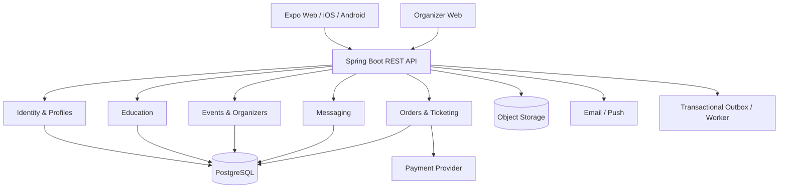

# Soberity — raport produktowo-techniczny i plan wdrożenia


> **NADRZĘDNA ZASADA PRODUKTU — SCIENCE FIRST, EVIDENCE ALWAYS.** Soberity jest platformą evidence-based: wszystkie twierdzenia o zdrowiu i wpływie alkoholu wymagają weryfikowalnych źródeł, uczciwego przedstawienia poziomu pewności oraz oddzielenia faktów od hipotez. Nie straszymy, nie wyolbrzymiamy i nie przedstawiamy korelacji jako przyczynowości. Szczegóły: rozdział 24.


**Wersja:** 1.4  
**Data:** 23.10.2026  
**Platformy:** web, iOS, Android  
**Status:** koncepcja / plan do walidacji, nie zatwierdzona specyfikacja  

## 1. Executive summary

**Soberity** to platforma edukacyjna, społecznościowa i eventowa promująca świadome życie bez alkoholu. Nie jest aplikacją do terapii uzależnień ani substytutem pomocy medycznej. Powinna być przyjazna zarówno osobom niepijącym, jak i osobom ograniczającym spożycie („sober curious”).

Trzy filary:
1. **Learn:** fiszki, quizy, obalanie mitów, materiały z naukowym źródłem.
2. **Discover & Attend:** odkrywanie wydarzeń bezalkoholowych, kontakt z organizatorem, a później zakup biletów.
3. **Connect:** społeczność, wydarzenia grupowe i wspierające wyzwania.

**Rekomendacja:** jeden produkt React Native + Expo + TypeScript (iOS/Android/web) z backendem **Java 21 LTS + Spring Boot** w architekturze **modularnego monolitu**. Dla rozbudowanego panelu organizatora zastosować oddzielną aplikację webową React/Next.js, współdzieląc kontrakty API i bibliotekę TypeScript, niekoniecznie komponenty UI.

**Strategia:** zacząć w jednym regionie i z ręcznie pozyskanymi organizatorami, zbudować użyteczny katalog wydarzeń oraz moduł wiedzy; dopiero po walidacji popytu wdrażać płatności i pełną społeczność. Pusta tablica wydarzeń lub pusta społeczność to największe zagrożenie produktowe.

## 2. Pozycjonowanie, odbiorcy i model wartości

### Misja
Ułatwić ludziom odkrywanie faktów o alkoholu, nawiązywanie relacji i znajdowanie alternatywnych sposobów spędzania czasu.

### Grupy docelowe
- **Sober curious:** zainteresowani ograniczaniem spożycia i wiedzą.
- **Alcohol-free lifestyle:** osoby, które nie piją i chcą znajdować ludzi oraz wydarzenia.
- **Zdrowie i sport:** zainteresowani snem, regeneracją i nawykami.
- **Organizatorzy B2B:** twórcy imprez bezalkoholowych, warsztatów, wydarzeń sportowych i społecznościowych.

### Propozycja wartości
- Dla użytkownika: „Dowiedz się, dlaczego — i znajdź z kim oraz gdzie”.
- Dla organizatora: dotarcie do właściwej publiczności, komunikacja, dystrybucja biletów i analityka wydarzeń.

### Zasady produktu
- Bez zawstydzania i moralizowania; nie obiecywać cudów zdrowotnych.
- Edukacja oparta na źródłach, ich jakości i aktualności; rozróżniać związek od przyczynowości.
- Funkcje społecznościowe powinny wspierać, a nie zastępować profesjonalnej pomocy.
- Prywatność domyślnie: nie pokazywać publicznie historii picia, abstynencji ani problemów zdrowotnych.
- Kontakt z organizatorem i bilet muszą działać łatwo także na webie, bez przymusowej instalacji aplikacji.

## 3. Zakres funkcjonalny — moduły

### 3.1 Konta i onboarding
- Logowanie e-mail / OAuth, weryfikacja adresu, reset/odzyskiwanie, usunięcie konta.
- Zainteresowania (nauka, sport, wydarzenia, społeczność), preferowane miasto i język.
- Rola `USER`, `ORGANIZER`, `MODERATOR`, `ADMIN`; role organizatorów nadawane po weryfikacji.
- Polityka prywatności, kontrola zgód, eksport i usunięcie danych.

### 3.2 Nauka
- Fiszki i quizy: prawda/fałsz, wielokrotny wybór; wyjaśnienie + źródła.
- Kategorie: alkohol i sen, mózg, nowotwory, sport, relacje, zdrowie publiczne.
- Biblioteka badań z metadanymi: DOI/URL, rok, rodzaj badania, ograniczenia, recenzja redakcyjna.
- Postęp nauki; nagradzanie udziału zamiast rywalizacji o długość abstynencji.
- Każdy materiał ma status `DRAFT`, `IN_REVIEW`, `PUBLISHED`, `ARCHIVED`.

### 3.3 Wydarzenia
- Lista i wyszukiwanie po mieście, terminie, typie, dostępności i cenie.
- Strona wydarzenia: lokalizacja, czas, cena, opis, organizator, zasady, dostępność, informacja „bez alkoholu”.
- Zapis/obserwowanie wydarzeń i powiadomienia o zmianach.
- W MVP link do zewnętrznej sprzedaży; później pełne zamówienie i kod QR.
- Metryki jakości podaży: aktywne wydarzenia w mieście, wejścia na stronę, kliknięcia rejestracji/zakupu.

### 3.4 Kontakt z organizatorem
- MVP: formularz pytania z antyspamem, powiadomieniem e-mail do organizatora i odpowiedzią e-mail albo w panelu.
- V2: wątki konwersacji użytkownik–organizator, zgłaszanie nadużyć, blokowanie, limity wiadomości.
- V3: czat w czasie rzeczywistym tylko wtedy, gdy istnieje realne zapotrzebowanie; unikać natychmiastowego tworzenia pełnego komunikatora.

### 3.5 Marketplace biletowy
- Weryfikacja organizatorów (w tym dokumentacja sprzedawcy potrzebna operatorowi płatności).
- Typy biletów, pula miejsc, limity na osobę, rabaty, waluta, VAT i warunki zwrotu.
- Zamówienie, rezerwacja puli na krótki czas, płatność, webhook, generowanie biletu QR.
- Check-in QR z ochroną przed powtórnym użyciem; zwroty, anulacje i reklamacje.
- Rozliczenia i prowizja platformy; historia zmian, reconciliation, konta organizatorów.

### 3.6 Społeczność (później)
- Grupy lokalne i tematyczne, wpisy, komentarze, obserwowanie organizatorów.
- „Kto idzie?” na zasadzie dobrowolnego opt-in, domyślnie niewidoczne.
- Regulamin treści, moderatorzy, zgłoszenia, blokady, narzędzia bezpieczeństwa i antyspam.

### 3.7 Dalsze rozszerzenia
- AI Myth Buster z odpowiedziami opartymi na kuratorowanej bazie i linkach do źródeł (RAG).
- Spersonalizowane rekomendacje wydarzeń, wyzwania, powiadomienia push.
- Integracje aktywności zdrowotnych tylko po analizie danych wrażliwych i wyraźnym opt-in.
- Panel statystyk dla organizatorów, program partnerski, wielojęzyczność.

## 4. Etapy wdrożenia i bramki decyzyjne

> Terminy są orientacyjne dla jednej osoby rozwijającej produkt w dużym wymiarze czasu, przy rozsądnym wykorzystaniu gotowych usług i narzędzi AI. Nie są obietnicą terminu; moderacja, prawo i akwizycja partnerów mogą istotnie wydłużyć projekt.

### Etap 0 — Discovery, walidacja i projekt (2–3 tygodnie)
**Cel:** upewnić się, że użytkownicy chcą korzystać z katalogu, a organizatorzy mają interes w obecności na platformie.

**Zakres:**
- 15–25 rozmów z użytkownikami i 5–10 z organizatorami w jednym mieście.
- Prosta strona zapisu, propozycja marki, badanie dostępności domeny i znaku towarowego.
- Makiety 5 kluczowych ekranów; zdefiniowanie eventów analitycznych.
- Podstawowa polityka redakcyjna i metodologia jakości badań.
- Decyzja o modelu operatora biletowego: platforma pośredniczy czy sprzedaje we własnym imieniu.

**Rezultat:** PRD, makiety, minimalny backlog, lista partnerów i jawne ryzyka.

**Go/no-go:** zainteresowanie co najmniej kilku organizatorów gotowych udostępniać swoje wydarzenia; mierzalny popyt po stronie odbiorców.

### Etap 1 — MVP edukacja + katalog wydarzeń (6–10 tygodni)
**Cel:** udowodnić, że użytkownicy odkrywają treści i wydarzenia i wracają.

**Zakres:**
- Konto/logowanie, profil podstawowy, onboarding.
- Quizy, fiszki, panel publikowania zweryfikowanych treści.
- Katalog wydarzeń, filtry, karta wydarzenia, profil organizatora.
- Formularz do kontaktu; zewnętrzny link do biletu.
- Panel administratora do tworzenia i zatwierdzania eventów.
- Responsywny web + build iOS/Android z tym samym modelem domenowym.
- Podstawowa analityka, błędy, backup, privacy basics.

**Poza zakresem:** własne płatności, czat real-time, feed społecznościowy, AI, mikroserwisy.

**Akceptacja:** można utworzyć konto, rozwiązać quiz, przeczytać źródło, odnaleźć event, wysłać pytanie i przejść do sprzedaży; treści i eventy można moderować.

### Etap 2 — Walidacja rynku i poprawa retencji (4–6 tygodni)
- Test dystrybucji w pierwszym mieście; zaproszenie pierwszych organizatorów.
- Ulubione wydarzenia, przypomnienia e-mail/push, śledzenie zainteresowań.
- Ulepszenie SEO publicznych stron wydarzeń; analityka lejka.
- Proste odznaki za naukę, lokalizacja PL/EN.
- Wybór kategorii eventów o najwyższej konwersji.

**Bramka:** rosnąca liczba aktywnych eventów, powracający użytkownicy, kliknięcia w kupno/zapis; organizatorzy chcą dodawać kolejne wydarzenia.

### Etap 3 — Bilety i organizatorzy (8–12 tygodni)
- Weryfikacja organizatora, self-service panel z tworzeniem wydarzenia i pul biletów.
- Integracja marketplace payments (np. Stripe Connect; sprawdzić aktualną dostępność kraju, KYC i metody rozliczenia).
- Checkout, rezerwacja zapasu, webhooki, idempotencja, reconciliation.
- Bilet QR, check-in, zwroty/odwołania, mail potwierdzający, raport rozliczeń.
- Formalizacja kwestii sprzedawcy, fakturowania, VAT, regulaminów i polityki zwrotów z doradcą.

**Bramka:** zamówienia nie mogą tworzyć nadmiernej sprzedaży ani podwójnego check-in; płatności i zwroty dają się rozliczyć do zera różnic.

### Etap 4 — Społeczność i komunikacja (6–10 tygodni)
- Grupy i posty tematyczne; moderacja, zgłaszanie, blokowanie.
- Wątki wiadomości organizator–uczestnik i system powiadomień.
- Dobrowolne „kto się wybiera”; wspólne wydarzenia grup lokalnych.
- Ochrona przed spamem i nękaniem; przegląd obowiązków wynikających z DSA.

**Bramka:** odpowiedni poziom moderacji i realne zaangażowanie, nie tylko liczba rejestracji.

### Etap 5 — Rozwój i skalowanie (ciągły)
- AI Myth Buster z RAG i redakcyjnie zatwierdzonymi źródłami.
- Rekomendacje, personalizacja, lokalizacje i języki.
- Analityka B2B, kupony/partnerstwa, ewentualne premium.
- Rozdzielanie komponentów backendu tylko po wykazaniu potrzeby operacyjnej.

## 5. Technologia i podział kodu

### Frontend użytkownika
- **React Native + Expo + TypeScript**, **Expo Router**, **React Native Web**.
- **TanStack Query** (cache server state), React Hook Form + Zod (formularze), Zustand tylko dla prostego stanu klienta, i18n.
- Uniwersalne komponenty dla quizów, profili, list, eventów; implementacje `.web.tsx` / `.native.tsx` dla specyficznych map, checkoutu, uploadów.
- Zależności w wersjach kompatybilnych z wybranym stabilnym Expo SDK; nie aktualizować automatycznie wszystkiego do najnowszych wydań.
- Budowy i dystrybucja: Expo EAS, TestFlight i Google Play Internal Testing, hosting statyczny/SSR zależnie od wymagań web SEO.

### Frontend organizatora / administracji
- Na początku: admin w webowej części Expo albo prosty React panel.
- Docelowo **Next.js + TypeScript** (dashboard, tabele, formularze, raporty i SEO stron publicznych, jeśli potrzebne).
- Wspólne: typy wygenerowane z OpenAPI, utility API client, modele domenowe, style/tokens. Nie forsować współdzielenia każdego komponentu.

### Backend
- **Java 21 LTS + aktualna wspierana wersja Spring Boot kompatybilna z Java 21** (zweryfikować w chwili inicjalizacji projektu).
- Spring Web MVC, Spring Security, Spring Data JPA, Bean Validation, Flyway, Actuator, Micrometer, springdoc OpenAPI (wersja kompatybilna).
- Uwierzytelnianie: OAuth2/OIDC u dostawcy tożsamości lub rozwiązanie własne z dobrze zabezpieczonymi sesjami; nie budować własnego protokołu auth.
- PostgreSQL; indeksy `city`, `starts_at`, `status`, `organizer_id`; wyszukiwanie tekstowe PostgreSQL i opcjonalnie PostGIS dla wyszukiwania odległościowego.
- Redis **opcjonalny od etapu 2/3**: rate limits, cache, krótkie rezerwacje. Nie jest wymagany do MVP.
- Pliki: S3-compatible object storage z presigned uploads; CDN.
- E-mail transakcyjny: dostawca SMTP/API; push przez Expo Notifications; zadania asynchroniczne na początek przez tabelę outbox + worker.
- Brak Kafka i Kubernetes w MVP. Event bus dopiero po pojawieniu się rzeczywistych potrzeb.

### Projekt repozytorium
```
soberity/
  apps/
    consumer/              # Expo: web/iOS/Android
    organizer-web/         # Next.js (od etapu 3)
  packages/
    api-client/            # TypeScript client z OpenAPI
    design-tokens/
    shared-utils/
  backend/
    src/main/java/com/soberity/
      identity/
      education/
      events/
      organizers/
      messaging/
      ticketing/
      payments/
      notifications/
      moderation/
      common/
    src/main/resources/db/migration/
  infra/
    compose/
    terraform/             # opcjonalnie później
  docs/
    adr/
    api/
    policies/
```

**Granice modułów:** moduły komunikują się przez jawne serwisy/interfejsy i zdarzenia domenowe; brak dowolnych odwołań między repozytoriami. Wprowadzać testy architektury (np. ArchUnit).

## 6. Architektura logiczna



Rozdzielenie na mikroserwisy ma sens dopiero po wykazaniu konieczności niezależnego skalowania, izolacji odpowiedzialności, cykli wdrożeń lub zespołów.

## 7. Model danych — encje podstawowe

| Encja | Najważniejsze pola / relacje |
|---|---|
| `users` | id UUID, email, display_name, locale, status, created_at |
| `user_preferences` | user_id, city, interests, privacy_settings |
| `organizers` | id, owner_user_id, name, verification_status, payment_account_id |
| `organizer_members` | organizer_id, user_id, role |
| `events` | id, organizer_id, title, description, start_at, end_at, timezone, city, venue, lat/lon, status, ticketing_mode |
| `ticket_types` | id, event_id, name, price_minor, currency, capacity, sale_start/end |
| `orders` | id, user_id, event_id, status, total_minor, currency, provider_session_id |
| `order_items` | order_id, ticket_type_id, quantity, unit_price_minor |
| `tickets` | id, order_item_id, attendee_name?, token_hash, status, checked_in_at |
| `payments` | id, order_id, provider_id, state, amount_minor, idempotency_key |
| `refunds` | id, payment_id, amount_minor, status, reason |
| `quiz_questions` | id, type, body, options, correct_answer, explanation, status |
| `research_sources` | id, title, DOI/URL, published_at, evidence_level, reviewed_at |
| `question_sources` | question_id, research_source_id |
| `quiz_attempts` | id, user_id, question_id, answer, correct, answered_at |
| `contact_threads` | id, event_id, organizer_id, user_id, status |
| `messages` | id, thread_id, sender_id, body, created_at, moderation_status |
| `reports` | id, reporter_id, target_type, target_id, reason, status |
| `outbox_events` | id, type, payload, status, retry_count, created_at |

Konwencje: daty w UTC (`timestamptz`), zachowanie strefy czasowej wydarzenia, pieniądze jako całkowite jednostki najmniejsze (`price_minor`) plus waluta, UUID identyfikatorów, `created_at`/`updated_at`, soft deletion tylko tam, gdzie ma sens prawny.

## 8. REST API — propozycja kontraktów

**Public:**
```
GET    /api/v1/events?city=Vienna&from=...&to=...&category=...
GET    /api/v1/events/{eventId}
GET    /api/v1/organizers/{organizerId}
GET    /api/v1/education/questions/daily
GET    /api/v1/education/articles/{slug}
```
**User:**
```
GET    /api/v1/me
PATCH  /api/v1/me
POST   /api/v1/education/attempts
POST   /api/v1/events/{eventId}/favorites
POST   /api/v1/events/{eventId}/contact
GET    /api/v1/me/orders
GET    /api/v1/me/tickets
```
**Organizer:**
```
POST   /api/v1/organizer/events
PATCH  /api/v1/organizer/events/{eventId}
GET    /api/v1/organizer/events/{eventId}/attendees
POST   /api/v1/organizer/tickets/check-in
GET    /api/v1/organizer/contact-threads
```
**Ticketing (etap 3):**
```
POST   /api/v1/orders
POST   /api/v1/orders/{orderId}/checkout-session
POST   /api/v1/orders/{orderId}/refund-request
POST   /api/v1/webhooks/payments
```

Przykładowa odpowiedź wydarzenia:
```json
{
  "id": "b30d8f3e-69dc-409e-b724-8ba6bbdb7a91",
  "title": "Sober Dance Night",
  "startsAt": "2027-03-20T19:00:00Z",
  "timezone": "Europe/Vienna",
  "location": {"city": "Vienna", "venue": "Example Venue"},
  "ticketingMode": "EXTERNAL",
  "externalTicketUrl": "https://example.org/tickets",
  "organizer": {"id": "b7db9af9-46ae-46e2-ac7b-6eb2cad6139e", "name": "Example Organizer"}
}
```

**Kontrakt i błędy:** OpenAPI, RFC 9457 Problem Details, kody HTTP, walidacja wejścia, wersjonowanie `/v1`, paginacja kursorowa dla feedów i offsetowa dla małych list. Autoryzacja po stronie backendu, nie tylko ukrywanie przycisków.

## 9. Proces biletowy i odporność transakcyjna

1. Użytkownik wybiera typ i liczbę biletów.
2. Backend w jednej transakcji sprawdza pulę i tworzy `PENDING` order + krótką rezerwację z TTL (np. 10 minut); zabezpiecza konkurencję przez blokadę rekordu lub atomową aktualizację warunkową.
3. Tworzona jest sesja płatności u operatora; przechowywać `provider_session_id` i klucz idempotencji.
4. Provider przesyła **zweryfikowany webhook**. Nie ufać tylko redirectowi klienta.
5. Obsługa webhooku deduplikuje `provider_event_id`; atomowo aktualizuje order na `PAID`, emisja zdarzenia do outbox i generowanie biletów.
6. QR oparty na losowym, nieprzewidywalnym tokenie; baza przechowuje hash, check-in zużywa token atomowo.
7. Job uzgadnia zamówienia z operatorem (reconciliation), odnawia lub zwalnia rezerwacje oraz obsługuje opóźnione płatności.
8. Zwroty i anulacje są jawnie modelowane; zapewnić obsługę sporów oraz chargebacków.

**Zasada:** `PAID` to stan potwierdzony przez zaufany webhook/odczyt API płatności, nie sukces pokazany przez aplikację. Konieczna polityka zachowania przy późnym webhooku i wygaśnięciu rezerwacji (np. zwrot i brak biletu, jeżeli pula została już zwolniona).

### Płatności i sklepy aplikacji
- Bilety na **fizyczne wydarzenia poza aplikacją** mogą korzystać z zewnętrznego operatora płatności; Apple wskazuje takie usługi w 3.1.3(e), a Google Play w zasadach wyjątków dla live events.
- **Cyfrowe premium, kursy lub funkcje wewnątrz aplikacji** mogą podlegać obowiązkowym rozwiązaniom in-app purchase i zależnym od rynku wyjątkom. Nie łączyć tych modeli bez przeglądu zasad sklepów.
- Stripe Connect to kandydat do rozliczeń marketplace, jednak należy zweryfikować KYC, obsługę krajów, opłaty, split, konto sprzedawcy, chargebacki i sytuację podatkową przed implementacją.

## 10. Bezpieczeństwo, prywatność i prawo

### Techniczne minimum produkcyjne
- HTTPS/TLS, HSTS, CSP i CSRF tam, gdzie dotyczy; bez sekretów w kliencie.
- OIDC/OAuth2 PKCE; krótkie access tokens, bezpieczne odnawianie sesji, secure storage w mobilce; dla web rozważyć httpOnly SameSite cookies/BFF.
- Role i uprawnienia na poziomie organizacji/zasobu; testy przeciw IDOR/BOLA.
- Rate limiting loginów, kontaktów i formularzy, captcha po wykryciu nadużyć.
- Secret manager lub bezpieczne zmienne środowiskowe; szyfrowanie danych w spoczynku i backupach.
- Audyt działań admina, weryfikacji organizatorów, zwrotów i wejść; nie logować tokenów, wiadomości prywatnych ani danych kart.
- Skanowanie zależności, SAST/DAST, regularne aktualizacje i zarządzanie podatnościami.
- Backup PostgreSQL codziennie i test odtworzenia; określić RPO/RTO i przećwiczyć awarię.
- Panel do zgłoszeń, blokad i usuwania treści; polityka retencji danych.

### GDPR/RODO i dane wrażliwe
- Informacja o abstynencji i problemach z alkoholem może ujawniać dane o zdrowiu — projektować przy założeniu wysokiej wrażliwości takich danych.
- Nie pytać o uzależnienie w MVP; nie zbierać danych, które nie są potrzebne. Jeśli przyszłe funkcje to wymagają, przeprowadzić ocenę podstawy prawnej i potencjalnie DPIA.
- Mechanizm realizacji praw użytkownika, minimalizacja, retencja, ewidencja podmiotów przetwarzających i transferów.
- Profil „sober” nie jest automatycznie publiczny; szczególnie prywatne quizy, historia i uczestnictwo.
- Polityka cookies i legalna podstawa dla analityki/marketingu.

### Marketplace i treści użytkowników
- W UE przeanalizować DSA: zgłoszenia nielegalnych treści, uzasadnienia decyzji moderacyjnych, przejrzystość i — jeśli model kwalifikuje się jako marketplace — odpowiednie obowiązki identyfikacji sprzedawców. Zakres wymogów zależy m.in. od wielkości i roli usługi.
- Regulaminy: platformy, organizatora, zakupu biletu, reklamacji, zwrotów, zakazów treści, sposobu weryfikacji eventu bez alkoholu.
- Ustalić kto formalnie sprzedaje bilet, kto odpowiada za wydarzenie i komu użytkownik zgłasza reklamację; skonsultować z prawnikiem i księgowym przed sprzedażą.
- Content policy dla badań: linki do oryginałów, ocena siły dowodów, audyt wersji i dat recenzji; ostrzeżenie przy poradach medycznych i potencjalnym ryzyku nagłego odstawienia alkoholu.

## 11. Testy, jakość i observability

- **Backend:** JUnit 5, Mockito do unit tests, Testcontainers PostgreSQL do integracyjnych, Spring MockMvc, WireMock do operatorów i e-mail, testy kontraktowe OpenAPI.
- **Płatności:** testy konkurencji zamówień, powtórnych webhooków, nieterminowych webhooków, refund, chargeback i powtórnego check-in.
- **Frontend:** Jest/Vitest i React Native Testing Library; end-to-end Maestro/Detox dla mobile, Playwright dla web.
- **Wspólne quality gates:** lint, TypeScript strict, dependency scan, migracje Flyway sprawdzane w CI, smoke tests staging.
- **Observability:** structured JSON logs, correlation/request ID, Micrometer+OpenTelemetry, Prometheus/Grafana lub managed alternativa, Sentry dla crash reports, alerty na brak webhooków, błędy checkoutu i 5xx.
- **Analityka produktowa:** privacy-aware event tracking bez przechowywania w analityce informacji o zdrowiu.

## 12. CI/CD i infrastruktura

### Lokalnie
Docker Compose: `postgres`, `backend`, opcjonalnie `redis`, emulator maila. Aplikacja Expo uruchamiana lokalnie. Seed danych demonstracyjnych.

### Środowiska
- `local`, `staging`, `production`; osobne bazy, domeny i klucze płatności.
- GitHub Actions: build/test/scan, Docker image, deploy staging, smoke test, manual approve production.
- Host: na MVP mały VPS z Docker Compose + reverse proxy (Caddy), certyfikaty TLS, firewall, private DB, backup offsite i monitoring. Zarządzany PostgreSQL zmniejsza ryzyko operacyjne, jeśli budżet pozwala.
- Obrazy z pinowanymi tagami/digest, automatyczne backupy, rolling restart i plan rollbacku bazy.
- Nie poleca się Kubernetes do początkowej skali.
- Web: statyczny hosting/CDN (jeśli SPA/statyczne renderowanie) albo hosting wspierający SSR dla publicznych stron wydarzeń.

## 13. UX i mapa ekranów

**Użytkownik:**
- Welcome / Login / Onboarding
- Home (fakt dnia, nadchodzące wydarzenia)
- Learn → Quiz → Odpowiedź → Źródło
- Explore Events → Filtry → Event Detail → Kontakt / Kup
- My Events / Tickets → QR (od etapu 3)
- Profile → Preferences / Privacy / Notifications
- Community (od etapu 4)

**Organizator:**
- Organizer Dashboard
- Company Verification
- My Events → Create/Edit
- Attendees / Tickets / Check-in
- Contact Inbox
- Payments / Refunds / Payouts

**Admin:**
- Content Review, Event Approval, Organizer Verification, Abuse Reports, Refund Audits, Metrics.

Na desktopie menu boczne i szerokie tabele; na mobile dolne taby i krótkie ścieżki do eventów. Zadbaj o a11y, kontrasty, klawiaturę i screen reader.

## 14. Monetyzacja

1. **Prowizja od biletów:** hipoteza 3–8% — przetestować z organizatorami; opłaty dostawców i ryzyko sporów liczyć osobno.
2. **Organizer Pro:** narzędzia analityczne, branding, kampanie, dodatkowe role; dopiero po zbudowaniu podaży.
3. **Wyróżnienia eventów:** oznaczone jako sponsorowane, bez manipulowania wynikami.
4. **Premium edukacyjne:** tylko gdy użytkownicy naprawdę wykazują popyt; pamiętać o zasadach App Store i Play dla treści cyfrowych.

**Przykładowa ekonomika** (czysto ilustracyjna): 10 wydarzeń miesięcznie × 100 biletów × 80 PLN × 5% = **4 000 PLN przychodu brutto platformy/miesiąc** przed opłatami operatora, podatkami, zwrotami i kosztami operacyjnymi. Nie jest to prognoza.

## 15. Budżet i wysiłek

### Scenariusz: założyciel rozwija aplikację samodzielnie
| Element | MVP – szacunek miesięczny (PLN) | Uwagi |
|---|---:|---|
| VPS / backend | 50–200 | zależnie od regionu, RAM, backupów |
| DB/backup/storage | 30–200 | self-host taniej, managed wygodniej |
| E-mail, monitoring, analityka | 0–200 | darmowe progi lub opłaty przy wolumenie |
| Domena i narzędzia | 10–100 | uśredniony koszt okresowy |
| **Razem orientacyjnie** | **90–700** | bez kosztu pracy, prawników, marketingu, app store i płatności |

Szacunki orientacyjne, **nie zweryfikowane oferty rynkowe**. Jednorazowo uwzględnić płatne konta deweloperskie, konsultacje prawne, branding, testy na urządzeniach i koszty promocji.

### Realistyczne ograniczenia czasowe
- Około 2–3 miesięcy na pierwsze techniczne MVP jest możliwe, ale nie obejmuje gwarancji zdobycia organizatorów i moderacji.
- Własna sprzedaż biletów to osobny projekt z kwestiami prawnymi i operacyjnymi; nie traktować jej jak prostej integracji przycisku „Pay”.

## 16. KPI i eksperymenty

**North-star candidate:** liczba użytkowników miesięcznie, którzy wykonali wartościową akcję: ukończyli lekcję **albo** zapisali się na wydarzenie / zakupili bilet. Docelowo rozbić ją na część edukacyjną i społeczną, aby jeden moduł nie maskował słabości drugiego.

| Obszar | Przykładowe metryki |
|---|---|
| Aktywacja | rejestracja → 1 quiz; rejestracja → obejrzenie 1 wydarzenia |
| Retencja | D7/D30, WAU/MAU, ukończone quizy / user |
| Events supply | wydarzenia dostępne na miasto / następne 30 dni |
| Events demand | views → contact / click-out / orders |
| Organizer | liczba aktywnych organizatorów, repeat listing rate |
| Ticketing | paid conversion, payment failure, refund rate, chargeback rate |
| Safety | czas moderacji zgłoszenia, liczba abuse reports, reklamacje |
| Economics | GMV, take rate, contribution margin, CAC, LTV (ostrożnie na początku) |

**Eksperymenty MVP:** (a) quiz „mit dnia” vs zwykła biblioteka; (b) organizatorowi łatwiej pozyskać kontakt z formularza czy sprzedaż zewnętrzną; (c) jaki typ sober eventu daje największą frekwencję.

## 17. Ryzyka i plan mitigacji

| Ryzyko | Prawdopodobieństwo / wpływ | Mitigacja |
|---|---|---|
| Pusty katalog eventów | wysokie / wysokie | start w jednym mieście, ręczna akwizycja i partnerstwa |
| Brak retencji edukacyjnej | średnie / wysokie | krótkie lekcje, mierzenie powrotów, personalizacja ostrożnie |
| Fałszywe lub słabe badania | średnie / wysokie | recenzja redakcyjna, bibliografia, wersjonowanie |
| Sprzedaż nieprawidłowych biletów | średnie / krytyczne | transakcje, testy współbieżności, webhook idempotence |
| Oszustwa organizatorów | średnie / wysokie | KYC, moderacja, AML/operator i polityki sporów |
| Naruszenie prywatności | średnie / krytyczne | privacy by design, minimalizacja, audyty |
| Toksyczna społeczność | średnie / wysokie | moderacja, zgłaszanie, ograniczenia DMs |
| Koszt utrzymania | średnie / średnie | monolit, proste zależności, managed usługi selektywnie |
| Odrzucenie przez app store | średnie / średnie | przegląd kategorii płatności, konta demo, testy na urządzeniach |
| Dostępność marki Soberity | nieustalone / wysokie | EUIPO, domeny, App Store/Play, badanie znaków |

## 18. Backlog w priorytetach

### P0 — przed publicznym MVP
- Auth, profil, zgody, usunięcie konta.
- Admin CRUD i moderacja wiedzy/eventów/organizatorów.
- Fiszki, quizy, źródła, progress.
- Katalog, search/filter, detail, city/timezone.
- Kontakt z organizatorem, zewnętrzny ticket link.
- Logging, backup, ochrona API, analityka i telemetry.
- Cross-platform testy na web/iOS/Android.

### P1 — po pierwszej walidacji
- Organizer self-service, ulubione, powiadomienia, wielojęzyczność.
- Dobre SEO publicznych eventów; import danych od partnerów za ich zgodą.

### P2 — po dowodach zapotrzebowania
- Checkout, Stripe Connect (albo alternatywa), QR, check-in, refund.
- Wiadomości, grupy, moderacja społeczności.

### P3 — później
- RAG/AI, zaawansowane rekomendacje, integracje z wearables, Organizer Pro.

## 19. Pierwsze 10 konkretnych zadań developerskich

1. Spisać ADR-001: Expo uniwersalnie + osobny organizer web w fazie wzrostu.
2. Spisać ADR-002: Spring Boot Java 21 modular monolith; nazewnictwo pakietów.
3. Zainicjalizować monorepo, ESLint/Prettier, TypeScript strict, test scripts.
4. Postawić `backend` z health check, Flyway, PostgreSQL + Docker Compose.
5. Dodać auth OIDC oraz role `USER/ORGANIZER/ADMIN`.
6. Zaprojektować i wystawić OpenAPI `GET /events` i `GET /events/{id}`.
7. Zbudować Expo event list + detail + web deep-link route.
8. Zbudować pierwszy quiz z naukowym źródłem, admin review i zapisem odpowiedzi.
9. Dodać formularz kontaktu z rate limit, powiadomieniem i logiem dostarczenia.
10. Skonfigurować staging, testy CI, error tracking i privacy-preserving product events.

## 20. Pytania do rozstrzygnięcia przed etapem 3

- Czy Soberity jest wyłącznie pośrednikiem, czy formalnym sprzedawcą biletów?
- Na jakim rynku zaczynamy (np. Wrocław, Warszawa, Wiedeń) i w jakiej walucie?
- Czy każde wydarzenie musi być całkowicie bez alkoholu? Jak to zweryfikować?
- Jakie są warunki zwrotu przy odwołanym wydarzeniu i kto podejmuje decyzję?
- Czy organizator sam publikuje event po weryfikacji, czy każda publikacja jest moderowana?
- Czy użytkownik może korzystać z wydarzeń i wiedzy bez konta?
- Czy aplikacja będzie kierowana tylko do dorosłych? Jak wdrożyć odpowiednią politykę wieku?

## 21. Źródła i literatura wdrożeniowa

- Expo Router, cross-platform i React Native Web: https://docs.expo.dev/router/introduction/ oraz https://docs.expo.dev/workflow/web/
- Spring Boot Kotlin (alternatywa językowa): https://docs.spring.io/spring-boot/reference/features/kotlin.html
- Apple App Review, sekcje płatności: https://developer.apple.com/app-store/review/guidelines/
- Google Play Payments Policy: https://support.google.com/googleplay/android-developer/answer/9858738?hl=pl
- Stripe Connect: https://docs.stripe.com/connect
- Komisja Europejska — DSA: https://digital-strategy.ec.europa.eu/en/policies/digital-services-act
- Komisja Europejska — special categories of data: https://commission.europa.eu/law/law-topic/data-protection/information-individuals_en

**Zastrzeżenie:** plan techniczny i biznesowy; nie stanowi opinii prawnej, medycznej ani gwarancji kosztów. Na etapie implementacji weryfikować aktualne wersje SDK, regulaminy płatności i wymogi danego kraju.


## 22. Soberity World Map — interaktywny atlas alkoholu (nowa funkcjonalność)

### 22.1 Cel produktu i inspiracja

Moduł inspirowany sposobem eksploracji danych w Electricity Maps: mapa świata kolorowana według wybranego wskaźnika, wybór kraju, porównanie państw, oś czasu, opis źródeł i metodyki. Jest to **atlas danych historycznych**, a nie śledzenie konsumpcji alkoholu w czasie rzeczywistym. Podstawowym celem jest edukacja i możliwość rzetelnego porównywania państw, nie stygmatyzacja ich mieszkańców.

**Podstawowe user stories:**
- Jako użytkownik wybieram „Roczne spożycie”, żeby zobaczyć kolorową mapę państw według litrów czystego alkoholu na osobę (15+) na rok.
- Klikam kraj i widzę wartość, rok, jednostkę, opis metodologii, źródło, dostępność danych historycznych i wykres trendu.
- Zmieniam warstwę: ogółem, piwo/wino/napoje spirytusowe, odsetek abstynentów, szacunkowy udział konsumpcji niezarejestrowanej, wybrane szkody zdrowotne (jeśli dane są porównywalne).
- Porównuję dwa kraje w tym samym roku i z tej samej definicji wskaźnika.
- Filtruję rok i rozpoznaję kraje bez danych (szary wzór / „brak danych”, nigdy sztuczne zero).
- W przyszłości oglądam gęstość zmapowanych punktów alkoholowych oraz dostępne wydarzenia sober w danym regionie.

### 22.2 Źródła danych i ograniczenia

| Wskaźnik | Proponowane źródło | Dostępność i caveat |
| --- | --- | --- |
| Łączne roczne spożycie alkoholu per capita 15+ | WHO Global Health Observatory, alternatywnie World Bank `SH.ALC.PCAP.LI` | Wysoka; litry **czystego alkoholu**, nie litry wszystkich napojów, uwzględnia szacunki konsumpcji nierejestrowanej. Rok obserwacji jawny. |
| Trend spożycia na przestrzeni lat | WHO / World Bank / Our World in Data | Wysoka/średnia; roczniki oraz definicje muszą pochodzić ze spójnej serii. |
| Spożycie według rodzaju alkoholu | WHO / Our World in Data | Zmienna; należy sprawdzać dostępność i rok każdej kategorii. |
| Odsetek abstynentów / osób pijących | WHO | Zmienna; zdefiniować okres, np. 12 miesięcy, i populację. |
| Szkody zdrowotne związane z alkoholem | WHO / IHME | Zmienna; wskaźniki standaryzować wiekowo i podawać niepewność. Nie mylić korelacji z przyczynowością. |
| Sklepy specjalistyczne / bary / puby | OSM (np. `shop=alcohol`, `shop=wine`, `amenity=bar`, `amenity=pub`) | Tylko **zmapowane obiekty**; znaczące różnice pokrycia między krajami. Nie są to wszystkie licencjonowane punkty. |
| Oficjalna liczba punktów posiadających zezwolenie | Krajowe / miejskie otwarte rejestry | Fragmentaryczna, różne definicje i licencje, trzeba badać jurysdykcja po jurysdykcji. |
| Prawne ograniczenia sprzedaży | WHO / właściwe instytucje rządowe | Różne poziomy regionalne, okresy obowiązywania i regulacje; wymaga ręcznej walidacji. |

Zasady publikowania danych:
1. Pokazywać `source`, `observedYear`, `publishedAt` lub `retrievedAt`, `unit`, `population`, `methodologyUrl`, `license` oraz `qualityLabel`.
2. Brak danych != 0; nie imputować wartości domyślnych bez jawnej flagi i opisanej metody.
3. Odróżniać odsetki od wartości bezwzględnych, surowe liczby punktów od wartości na 100 tys. mieszkańców.
4. OSM: prezentować opis „liczba zmapowanych obiektów z wybranymi tagami”, a nie „liczba wszystkich punktów sprzedaży”. Nie sumować bezrefleksyjnie barów i sklepów, nie wyciągać wniosków o ich dostępności bez korekty na kompletność.
5. Przed wykorzystaniem zestawu danych sprawdzić licencję, dozwoloną redystrybucję i obowiązkową atrybucję (WHO, World Bank, OSM / ODbL, podkłady mapowe).
6. Nie klasyfikować narodów jako „zdrowych” / „niezdrowych” samym kolorem; neutralna skala, legenda i definicja miary.

Źródła startowe:
- https://data.who.int/indicators/i/EF38E6A/EE6F72A
- https://www.who.int/data/gho/data/indicators/indicator-details/GHO/alcohol-total-per-capita-%2815-years%29-consumption-%28in-litres-of-pure-alcohol%29
- https://data.worldbank.org/indicator/SH.ALC.PCAP.LI
- https://ourworldindata.org/alcohol-consumption
- https://wiki.openstreetmap.org/wiki/Tag:shop%3Dalcohol
- https://www.electricitymaps.com/platform/map

### 22.3 Interfejs i UX

- Widok `Explore > World Map`: choropleth mapy świata, legenda wartości i filtr wskaźnika.
- Kontrolka roku — tylko lata rzeczywiście dostępne dla danego zestawu; opcjonalnie oś czasu z animacją zmian.
- Dotknięcie lub kliknięcie kraju otwiera panel z metryką, wykresem trendu, porównaniem do regionu, źródłami i zastrzeżeniami.
- Compare mode: wybór maks. dwóch krajów, te same definicje, jednostka i rok.
- Domyślnie skala ciągła dobrana do rozkładu; bezdanych nie barwić jak zerowych. Alternatywa palety przyjaznej osobom z zaburzeniami widzenia barw.
- Web: tooltip po najechaniu + dostępna tabela danych; mobile: bottom sheet + tap; nawigacja i czytniki ekranu.
- Linkowanie z mapy do materiałów edukacyjnych oraz w przyszłości sober eventów w państwie.

### 22.4 Architektura frontendu

- **Web:** MapLibre GL JS; nadaje się do choropleth na poligonach krajów i interaktywnych warstw.
- **iOS / Android:** MapLibre React Native (natywny MapLibre); wymaga zgodnej wersji RN i development build Expo. Nie zakładać, że jest obsługiwany przez Expo Go.
- Współdzielić w TypeScript: typy wskaźników, kontrolki filtrów, fetch hooks, legendy, skale kolorów, formattery liczb, modele panelu kraju, a nie sam widok mapy.
- Osobne komponenty `WorldMap.web.tsx` i `WorldMap.native.tsx` lub adapter `MapRenderer`.
- Render mapy na podstawie GeoJSON/topologii granic państw ISO 3166-1 alpha-3 i zestawu `countryCode -> metric` (preferować zoptymalizowane kafle wektorowe w razie potrzeby). Licencja geometrii wymaga odrębnej weryfikacji.
- W aplikacji źródła/wskaźniki ładowane są z własnego backendu, nie bezpośrednio z WHO/Overpass przy każdym otwarciu.

### 22.5 Backend Java/Spring Boot i import danych

Dodać moduł `worldmap` do modularnego monolitu:
- `WorldMapController` — tylko odczyt dla użytkownika;
- `IndicatorCatalogService` — katalog wskaźników i definicje jednostek;
- `CountryMetricQueryService` — agregaty i serie czasowe;
- `DatasetImportJob` — cykliczny import z API/CSV, mapowanie krajów, walidacja i publikacja wersjonowanych snapshotów;
- `DataProvenanceService` — pochodzenie, licencje, aktualność danych.

Pipeline: pobranie danych -> staging -> walidacja (ISO3, unit, year, zakres) -> idempotentny upsert -> snapshot publikacji -> cache/CDN. Zachować oryginalne pliki i checksum importu. Automatyczny import okresowy (np. miesięczna kontrola aktualizacji, nie codzienne wymuszanie nowych liczb rocznych) + ręczna możliwość ponownego uruchomienia.

Proponowane encje/tabele:
```sql
indicator_definition(id, code, title, unit, population_scope, methodology_url)
data_source(id, name, base_url, license, attribution)
dataset_version(id, source_id, imported_at, published_at, source_revision, checksum)
country_indicator_value(id, iso3, indicator_id, observed_year, value_numeric,
                        dataset_version_id, quality_flag, UNIQUE(iso3, indicator_id, observed_year, dataset_version_id))
country_location_stat(id, iso3, region_code, observed_year, location_category,
                      mapped_count, density_per_100k, source_id, coverage_note)
```
Dla oficjalnych danych punktów sprzedaży zachować odrębny `methodology`/`coverage` i **nie łączyć** z OSM w jednym rankingu bez uzgodnienia definicji.

API (przykłady):
```http
GET /api/v1/world-map/indicators
GET /api/v1/world-map/values?indicator=ALCOHOL_TOTAL_APC&year=2020
GET /api/v1/world-map/countries/POL?indicator=ALCOHOL_TOTAL_APC
GET /api/v1/world-map/countries/POL/timeseries?indicator=ALCOHOL_TOTAL_APC
GET /api/v1/world-map/compare?countries=POL,AUT&indicator=ALCOHOL_TOTAL_APC&year=2020
GET /api/v1/world-map/sources/{datasetVersionId}
```
Przykładowy kontrakt wartości:
```json
{
  "indicator": "ALCOHOL_TOTAL_APC",
  "unit": "L_PURE_ALCOHOL_PER_PERSON_PER_YEAR",
  "population": "AGE_15_PLUS",
  "year": 2020,
  "values": [{"countryIso3": "POL", "value": 11.7, "quality": "REPORTED_OR_ESTIMATED"}],
  "source": {"name": "World Bank / WHO", "retrievedAt": "2026-10-23", "url": "https://data.worldbank.org/indicator/SH.ALC.PCAP.LI"}
}
```
Powyższa wartość jest przykładem z historycznego zestawu za 2020 r., nie aktualnym pomiarem. W produkcji dane pochodzą z importowanego snapshotu i jego rzeczywistej daty.

### 22.6 Implementacja etapami i kryteria akceptacji

**Mapa M0 — walidacja / prototyp (w etapie 0–1):** statyczny zestaw WHO/World Bank z jednym rokiem + interaktywne państwa + źródła. Zero punktów sprzedaży.

**Mapa M1 — wersja publiczna (po MVP, sugerowany etap 2):** roczne spożycie 15+, zoom, legenda, panele kraju, brakujące dane, responsywny web/iOS/Android; weryfikacja licencji i testy kolorów.

**Mapa M2 — dane historyczne i porównania (etap 3 lub 4):** timeline, wykresy, porównanie dwóch państw, kolejne oficjalne wskaźniki, cache, metryki importu.

**Mapa M3 — punkty sprzedaży (pilotaż osobno, etap 4 lub 5):** jeden rynek, np. wybrane miasto/kraj, integracja rejestru urzędowego lub snapshotu OSM; opis kompletności, kategorie, zagęszczenie na 100 tys. mieszkańców i jasno oznaczone braki. Dopiero po ocenie jakości rozbudowa geograficzna.

**Kryteria akceptacji M1:** poprawne ISO3 dla kraju, zgodny rok i jednostka z bazą danych, poprawnie wyróżnione braki, działanie na web/iOS/Android, dostępność tabelaryczna, udokumentowana atrybucja, brak zapytań do zewnętrznego API przy każdym przesunięciu mapy, testy API/importu i podstawowy monitoring.

### 22.7 Ryzyka i decyzje

- **Największe ryzyko nie jest programistyczne, lecz jakości danych**, zwłaszcza liczba licencjonowanych punktów sprzedaży w skali globalnej.
- Nie próbować budować „live alcohol tracker” — brak globalnego strumienia konsumpcji w czasie rzeczywistym.
- Nie wprowadzać nieuzasadnionego współczynnika „oceny kraju” sumującego arbitralne dane.
- Warto udostępnić neutralny, publiczny link do mapy w web, co może wspierać organiczny ruch i udostępnianie wyników.
- Opcjonalnie oferować eksport danych lub kart porównania z bezpośrednią atrybucją źródła, z zachowaniem warunków licencji.

### 22.8 Dokumentacja biblioteki mapowej

- https://maplibre.org/maplibre-gl-js/docs/
- https://maplibre.org/maplibre-react-native/docs/setup/getting-started/

**ADR-003:** MapLibre jako warstwa renderująca; własny katalog zweryfikowanych snapshotów danych w Spring Boot; osobne rendery web/native; brak obietnicy aktualizacji w czasie rzeczywistym.

---

## 23. Soberity Brain Lab — interaktywny wpływ alkoholu na mózg

**Status:** propozycja funkcjonalna; do przeglądu przez eksperta medycznego przed publikacją.  
**Priorytet:** eksperymentalne MVP edukacyjne po etapie podstawowych quizów (etap 2); rozbudowana wizualizacja 3D w etapie 4–5.

### 23.1 Cel i zasada rzetelności

Interaktywny moduł edukacyjny, w którym osoba wybiera rodzaj i ilość alkoholu, scenariusz spożycia (jednorazowe vs regularne) i poznaje **udokumentowane mechanizmy oraz ryzyka dotyczące funkcji i zdrowia mózgu**. Moduł **nie diagnozuje** użytkownika, nie estymuje liczby utraconych neuronów, nie pokazuje wiarygodnego „procentu zniszczenia mózgu” po konkretnej dawce i nie udaje spersonalizowanego skanu MRI.

Należy rozdzielić:
- **Ostre, przejściowe skutki spożycia:** pogorszenie oceny sytuacji, reakcji, koordynacji, pamięci; ich nasilenie zależy od wielu czynników i nie da się go wyznaczyć tylko na podstawie liczby drinków.
- **Długookresowe skojarzenia i zagrożenia:** przewlekłe, szczególnie intensywne spożycie może prowadzić do zmian w strukturze i funkcjonowaniu mózgu; wyniki obserwacyjne nie dowodzą bezpośrednio skutku u konkretnej osoby.
- **Regeneracja:** część zmian funkcjonalnych i strukturalnych może się poprawić w okresie abstynencji, ale skala i tempo są zróżnicowane.

Unikać dramatyzowania, fałszywej dokładności i kategorycznych komunikatów „X piw = Y% uszkodzenia”. Kolory na modelu oznaczają **obszary związane z omawianymi funkcjami**, a nie tkankę, która została uszkodzona u użytkownika.

### 23.2 UX / kluczowe funkcje

1. **Wybór porcji:** piwo, wino, napój spirytusowy lub własny napój; objętość ml oraz ABV (%). Liczba gramów etanolu = `objętość_ml × (ABV / 100) × 0,789 g/ml`. Przykład: 500 ml piwa 5% ≈ 19,7 g etanolu. Wartości są obliczeniem ilości etanolu, **nie** prognozą uszkodzeń.
2. **Tryb „Co dzieje się teraz?”:** karta skutków możliwych przy ostrym spożyciu, z przykładami funkcji mózgu i zachowania. Brak liczbowego przypisywania objawów do konkretnej dawki lub kalkulatora „kiedy można prowadzić”.
3. **Tryb „Nawyki przez lata”:** scenariusze edukacyjne o ryzyku przy rosnącej częstości i wielkości spożycia; jakościowe etykiety „dane o związku/ryzyku”, nie indywidualna prognoza zmian anatomicznych.
4. **Interaktywny mózg 2D/3D:** kliknięcie w korę przedczołową (decyzje), hipokamp (pamięć), móżdżek (koordynacja) itd. Pokazywać opis funkcji, różnice między skutkiem krótkoterminowym a długoterminowym oraz źródło. Zaznaczenia mają status ilustracyjny, nie diagnostyczny.
5. **Oś czasu badań:** przykładowe wyniki badań populacyjnych z jawnym rokiem, próbą badawczą i zastrzeżeniami dot. korelacji/konfuzji.
6. **Test wiedzy:** po eksploracji użytkownik otrzymuje 3 pytania, np. „Czy można wyliczyć utracone neurony z liczby wypitych piw?” (nie).
7. **Tryb dostępności:** opisy tekstowe, lista obszarów zamiast obracania 3D, wyłączenie animacji, brak kodowania znaczenia wyłącznie kolorem.
8. **Bezpieczeństwo:** ekran kierujący do pomocy medycznej dla osób z objawami ciężkiego zatrucia lub ryzykiem odstawienia. Należy unikać sugestii samodzielnego, nagłego odstawienia przy uzależnieniu fizycznym.

### 23.3 Projekt wizualizacji

**MVP:** lekka ilustracja 2D SVG z wybieralnymi regionami i kartami treści — identyczna logika na web/iOS/Android, bez kosztownych modeli. Wybór napoju zmienia zakres informacji wyświetlanej obok, **nie** „stopień zaczerwienienia uszkodzeń”.

**Wersja późniejsza:** 3D mózgu z wysokiej jakości, licencjonowanym modelem anatomicznym. Na web: Three.js / React Three Fiber. Mobile: test zgodności Expo/React Native z wybranym rendererem (np. Expo GL i three) oraz budżetu pamięci i wydajności przed decyzją. Możliwa osobna implementacja web/native. Nie blokować wydania na rzecz 3D.

Przykładowy ekran: panel „Ile etanolu?” (napój, ml, ABV) → „Co wiemy o wpływie na mózg” → zakładki „Krótki termin”, „Regularne picie”, „Co mówi nauka” → ilustracja mózgu z hotspotami → karta źródła i ograniczeń.

### 23.4 Architektura i model treści

- Frontend: `features/brain-lab` w Expo / React Native, shared UI i typy TS; obliczanie gramów etanolu lokalnie oraz walidacja na serwerze przy zapisie.
- Backend: moduł `brainlab` w modularnym monolicie Spring Boot. W pierwszej wersji API dostarcza **recenzowane treści** i powiązania obszar–funkcja–źródło, a nie spersonalizowany model predykcyjny.
- PostgreSQL: `brain_region(id, code, label, description)`, `brain_effect(id, effect_type, title, summary, limitations, review_status, reviewed_at)`, `brain_effect_region(effect_id, region_id)`, `brain_effect_source(effect_id, source_id)`, `science_source(id, doi_or_url, published_at, evidence_type, sample_size, citation)`.
- REST: `GET /api/v1/brain-lab/regions`, `GET /api/v1/brain-lab/effects?scenario=ACUTE|LONG_TERM`, `GET /api/v1/brain-lab/effects/{id}`, `GET /api/v1/brain-lab/content-version`.
- ContentOps: statusy `DRAFT -> MEDICAL_REVIEW -> PUBLISHED -> ARCHIVED`; każda karta ma recenzenta, źródła, historię zmian i datę ponownej weryfikacji.
- Nie zbierać historii spożycia w MVP; jeśli później pojawi się osobisty tracker, zapewnić wyraźną zgodę, minimalizację danych, politykę retencji i analizę wymagań RODO dla danych dotyczących zdrowia.

### 23.5 Wdrożenie etapami

**B0 — walidacja merytoryczna (1–2 tyg. orientacyjnie):** ekspert medyczny definiuje dopuszczalne sformułowania, weryfikuje źródła i schematy wizualizacji. Gotowa lista 8–12 tematów (pamięć, osąd, reakcja, koordynacja, zmiany związane z przewlekłym spożyciem, regeneracja).

**B1 — MVP 2D (2–4 tyg. orientacyjnie):** kalkulator gramów etanolu, interaktywne regiony mózgu, karty edukacyjne, cytowania i ostrzeżenia. Funkcja może działać bez logowania. Testy UI i dostępności na trzech platformach.

**B2 — treści interaktywne (2–4 tyg.):** scenariusze, quizy, przełącznik efekty ostre / długoterminowe, publikowanie kart przez panel administracyjny, analityka anonimowa.

**B3 — 3D i porównania badawcze (oddzielna decyzja):** prototyp wydajnościowy, animacje opatrzone informacją „schemat edukacyjny”, porównania z badań populacyjnych bez przypisywania wyniku użytkownikowi.

Podane przedziały dotyczą przybliżonego nakładu jednego developera i **nie** uwzględniają pełnego cyklu recenzji medycznej, prawnej, artystycznej lub testów klinicznej komunikacji.

### 23.6 Kryteria akceptacji i antywymagania

- Każdy skutek i hotspot posiada źródło naukowe oraz opis ograniczeń; treści zdrowotne zatwierdzone przed publikacją.
- Kalkulator etanolu prawidłowo przelicza ml i ABV, poprawnie odróżnia gramy etanolu od liczby porcji standardowych (różniącej się między państwami).
- Brak funkcji „ile neuronów straciłeś”, „% uszkodzenia”, spersonalizowanej diagnozy, przewidywanego BAC wyłącznie z liczby drinków czy wskazania bezpiecznego prowadzenia.
- Hotspoty mapują funkcje mózgu; nie sugerują, że konkretny region został fizycznie uszkodzony po wpisanej ilości alkoholu.
- Testy unit kalkulatora; testy treści i kontraktów API; testy dostępności klawiatura/screen reader/reduced motion.
- Źródła jawne i możliwe do otwarcia z każdego ekranu; wersjonowanie treści i audyt recenzji.

### 23.7 Literatura wyjściowa

- NIAAA: Alcohol and the Brain — https://www.niaaa.nih.gov/alcohols-effects-health/alcohol-topics/health-topics-alcohol-and-brain
- NIAAA: Alcohol and the Brain: An Overview — https://www.niaaa.nih.gov/publications/alcohol-and-brain-overview
- NIAAA: Neuroscience: The Brain in Addiction and Recovery — https://www.niaaa.nih.gov/health-professionals-communities/core-resource-on-alcohol/neuroscience-brain-addiction-and-recovery
- Daviet et al. (2022), *Nature Communications*, UK Biobank, n=36 678: https://www.nature.com/articles/s41467-022-28735-5 — badanie obserwacyjne: związek między konsumpcją a parametrami obrazowania, nie indywidualna predykcja szkód.

**ADR-004:** Brain Lab początkowo jako interaktywna ilustracja edukacyjna 2D z treściami recenzowanymi; 3D opcjonalne; brak pseudo-naukowych przeliczników dawki na uszkodzenia.


---

## 24. Scientific Integrity Policy — nadrzędna zasada Soberity

**Status: obowiązkowy standard produktu (cross-cutting requirement).** Wymagania poniżej dotyczą wszystkich modułów: fiszek, artykułów, World Map, Brain Lab/Body Lab, rekomendacji i odpowiedzi AI. Decyzje produktowe, które naruszają tę politykę, nie powinny trafiać na produkcję.

### 24.1 Misja i komunikacja

**Science first. Evidence always.** Soberity wspiera świadome wybory zdrowotne poprzez sprawdzalną, aktualizowaną wiedzę naukową. Celem jest edukacja, nie stygmatyzowanie osób pijących ani straszenie. Nie zastępuje profesjonalnej porady medycznej ani leczenia uzależnienia. Nie sugeruje, że statystyki populacyjne określają los konkretnej osoby.

### 24.2 Siedem zasad redakcyjnych

1. **Weryfikowalne źródła:** każda istotna teza zdrowotna posiada przynajmniej jedno źródło i link do publikacji/dokumentu, z DOI/PMID, jeśli dostępne; nie cytować źródeł nieistniejących.
2. **Hierarchia dowodów:** preferować aktualne przeglądy systematyczne i metaanalizy, uznane wytyczne oraz dobre badania pierwotne; oceniać jakość metodologiczną, a nie tylko typ publikacji.
3. **Korelacja ≠ przyczynowość:** przy badaniach obserwacyjnych używać języka „wiąże się z”, nie „powoduje”, jeśli związek przyczynowy nie został wiarygodnie ustalony.
4. **Uczciwa prezentacja ryzyka:** gdy możliwe, podawać ryzyko bezwzględne obok względnego, populację, dawkę, horyzont czasowy i przedziały niepewności.
5. **Brak pozornej precyzji:** nie przeliczać mililitrów alkoholu na „% uszkodzenia mózgu”; nie sugerować skutków indywidualnych na podstawie średnich populacyjnych.
6. **Transparentność i aktualizacja:** daty publikacji i ostatniej recenzji, jawne ograniczenia, historia korekt i zasady wycofywania nieaktualnych informacji.
7. **AI pod kontrolą źródeł:** generowanie może ułatwiać wyszukiwanie i objaśnianie wiedzy, ale nie może zastępować redakcji naukowej i weryfikacji twierdzeń.

### 24.3 Standard karty twierdzenia (Evidence Card)

Każda fiszka, hotspot lub panel statystyczny zawiera lub udostępnia po kliknięciu:

- **Tezę i zakres:** czego dokładnie dotyczy (np. ryzyko raka, populacja 15+, okres i rodzaj spożycia).
- **Wniosek w zrozumiałym języku**, bez sensacyjnych sformułowań.
- **Siłę pewności:** `HIGH | MODERATE | LOW | VERY_LOW | INSUFFICIENT`, wraz z uzasadnieniem; dla statystyk opis jakości i kompletności danych zamiast udawania oceny przyczynowości.
- **Źródła:** tytuł, autor/instytucja, rok, link, DOI/PMID jeśli istnieje; określenie typu badania.
- **Ograniczenia:** np. badanie obserwacyjne, błąd pomiaru, brak uogólnienia na konkretną osobę.
- **Daty:** rok danych, data weryfikacji i kolejnej planowanej recenzji.

Dla treści dotyczących ostrych objawów odstawienia lub potencjalnego uzależnienia dodać informację o konieczności konsultacji medycznej; gwałtowne odstawienie po długotrwałym intensywnym piciu może być niebezpieczne.

### 24.4 Reguły specyficzne dla map i symulatorów

**World Map:** podawać definicję wskaźnika, mianownik (np. litry czystego alkoholu na osobę 15+ rocznie), rok, źródło, pokrycie terytorialne, niepewność i brakujące dane. Nie zestawiać bez ostrzeżenia liczb punktów sprzedaży z OpenStreetMap jako porównywalnych oficjalnych statystyk państwowych. Odróżniać brak danych od wartości zero; nie nazywać danych rocznych „live”.

**Brain Lab:** dawka napoju może być przeliczana wyłącznie na przybliżoną ilość etanolu według znanego ABV i objętości. Wizualizacja pokazuje badane funkcje i możliwe mechanizmy, a nie symulowane uszkodzenie mózgu konkretnego użytkownika. Przy każdej animacji widoczna etykieta „ilustracja edukacyjna” i źródło naukowe.

### 24.5 Proces publikacji (evidence governance)

1. Redaktor proponuje tezę i wyszukuje źródła w uznanych bazach/publikacjach.
2. Ocenia rodzaj badania, ryzyko błędu, aktualność, sprzeczne wyniki i możliwość uogólnienia.
3. Tworzy kartę twierdzenia z ograniczeniami i poziomem pewności.
4. Materiał przechodzi recenzję merytoryczną niezależnej osoby z kompetencjami w danym obszarze przed publikacją; dla treści wysokiego ryzyka rekomendowana recenzja specjalisty klinicznego.
5. Publikacja otrzymuje wersję, autora, recenzenta i datę ponownej oceny.
6. Zaplanowane przeglądy (np. co 12 miesięcy) i pilne korekty po istotnych nowych dowodach; użytkownik może zgłosić błąd.

MVP może początkowo wykorzystywać ograniczoną, ręcznie recenzowaną bibliotekę zamiast dużej, automatycznie generowanej bazy. Nie należy automatycznie publikować zdrowotnych odpowiedzi AI bez kontroli jakości.

### 24.6 Implementacja techniczna

Proponowane encje w PostgreSQL:

```text
ScientificSource(id, title, authors, organization, year, url, doi, pmid, study_type, publication_date, retrieved_at)
EvidenceClaim(id, claim_text, summary, evidence_level, limitations, population, exposure, outcome, status, next_review_at)
ClaimSource(claim_id, source_id, relation, notes)
ScientificReview(id, claim_id, reviewer_id, reviewed_at, decision, version, notes)
ClaimRevision(id, claim_id, version, change_summary, changed_at, changed_by)
ContentEvidenceLink(content_type, content_id, claim_id)
```

- `status`: `DRAFT → IN_REVIEW → APPROVED → PUBLISHED → ARCHIVED`.
- Tylko opublikowane i recenzowane twierdzenia mogą być wykorzystywane przez interfejs edukacyjny oraz system RAG.
- API: `GET /api/v1/evidence/claims/{id}`, `GET /api/v1/evidence/sources/{id}`, `POST /api/v1/evidence/reports` (zgłoszenia błędów). Endpointy redakcyjne wymagają RBAC i audytu.
- Frontend: współdzielony komponent `EvidenceBadge`, `EvidenceDetails`, `SourceList`, obsługa stanów „niewystarczające dowody” i „brak danych”.
- Testy: brak publikacji bez źródła lub recenzji, walidacja poprawności DOI/URL, przegląd kontraktów API, brak nieuprawnionych etykiet „potwierdzone”, kontrola cytowań AI i testy regresyjne treści.
- RAG: wyszukiwanie w zatwierdzonym korpusie, cytowanie konkretnych źródeł, możliwość odpowiedzi „brak wystarczających danych”, telemetryka błędnych cytowań; bez wymyślania publikacji.

### 24.7 Kryteria akceptacji — obowiązują w całym projekcie

- 100% publikowanych kart edukacyjnych dotyczących zdrowia ma źródła i informację o ograniczeniach.
- Każda wizualizacja ryzyka zawiera definicję miary i zakres jej interpretacji.
- Każde stwierdzenie o związku przyczynowym przechodzi kontrolę adekwatności dowodów.
- Daty i wersje treści są audytowalne; użytkownik może zgłosić błąd.
- Niewystarczające dane i niepewność są komunikowane jawnie, a nie ukrywane.

**ADR-005:** Evidence-based to twarde wymaganie architektoniczne i redakcyjne Soberity, nie opcjonalna funkcja; bez potwierdzonych źródeł i recenzji nie publikujemy twierdzeń o wpływie alkoholu na zdrowie.

---

## 25. Discover & Retention — cotygodniowe badania, mini-gry i powroty do aplikacji

### 25.1 Cel i założenia

Celem nie jest maksymalizacja czasu spędzanego na ekranie, lecz **regularne, dobrowolne powroty wynikające z ciekawości, realnej wartości edukacyjnej i relacji społecznych**. Moduł łączy treści naukowe, krótkie aktywności i wydarzenia. Wszystkie elementy dotyczące zdrowia podlegają nadrzędnej **Scientific Integrity Policy** (rozdział 24).

Główny punkt wejścia: zakładka **Discover**, prezentująca „badanie tygodnia”, bieżące mini-gry, fragment World Map lub Brain Lab oraz wydarzenia w pobliżu (wyłącznie po udzieleniu odpowiedniej zgody lokalizacyjnej albo wybraniu miasta).

### 25.2 Zakres funkcjonalny

| Funkcja | Zachowanie użytkownika | Częstotliwość | Faza |
|---|---|---|---|
| **Weekly Science Drop** | Krótka historia o nowym lub wartym przypomnienia badaniu; jeden wniosek, jedno pytanie, karta źródeł i ograniczeń | 1× w tygodniu | MVP |
| **Myth Battle** | 3 pytania typu prawda/fałsz lub wybór wielokrotny z wyjaśnieniem i odnośnikiem do dowodów | Opcjonalnie codziennie | MVP |
| **Science Passport** | XP i odznaki za naukę, ukończenie lekcji oraz eksplorację, bez kar za nieobecność | Ciągły | MVP-lite / P1 |
| **Guess the Country** | Porównanie rocznego spożycia alkoholu między dwoma państwami na podstawie zgodnych wskaźników, lat i definicji | Nowa runda tygodniowo | P1, po World Map |
| **Brain Explorer** | Odkrywanie funkcji obszarów mózgu, quizy i odblokowywanie treści; bez symulowania procentu zniszczonej tkanki | Według wyboru | P1/P2, po Brain Lab |
| **Party Decisions** | Rozgałęzione historie ćwiczące reakcje na presję społeczną i asertywność | Sezonowe zestawy | P2 |
| **Soberity Missions** | Dobrowolne misje: quiz, odkrycie badania, udział w wydarzeniu, wspólna aktywność | Tygodniowo / miesięcznie | P2 |
| **Event Discoveries** | Spersonalizowane propozycje wydarzeń w mieście użytkownika, nowe wydarzenia obserwowanych organizatorów | Zależnie od podaży | MVP/P1 |

**Przykładowy przepływ:** użytkownik otwiera Weekly Science Drop → odpowiada na pytanie → otwiera źródło i ograniczenia → rozgrywa Myth Battle → zdobywa odznakę wiedzy → odkrywa powiązany temat na mapie → przegląda wydarzenie w swoim mieście. Zakupy i udział w wydarzeniach są opcjonalne.

### 25.3 Projekt treści „badanie tygodnia”

Format karty: `tytuł`, `hook/teaser`, `pytanie startowe`, `kluczowy wniosek`, `co naprawdę ustalono`, `czego nie ustalono`, `populacja`, `metoda`, `poziom pewności`, `odsyłacze do EvidenceClaim/ScientificSource`, `data publikacji`, `data recenzji`, `język`, `data emisji`.

- Nie przedstawiać każdego artykułu jako „nowego odkrycia”. Informować, czy badanie jest nowe, czy to ponownie omówiona praca starsza.
- Tytuły mają zaciekawiać bez clickbaitu; bez absolutnych stwierdzeń niezgodnych z dowodami.
- Redaktor może przygotować pulę zaakceptowanych materiałów z harmonogramem publikacji; treść przechodzi istniejący proces recenzji z rozdziału 24.
- Każda fiszka i wynik gry odsyła do konkretnego zatwierdzonego twierdzenia naukowego. Przy braku wystarczających danych dopuszcza się odpowiedź „nie wiadomo / zależy”, zamiast fałszywej dychotomii.

### 25.4 Zasady grywalizacji i etyka

- XP nagradza zdobywanie wiedzy i aktywności edukacyjne, **nie** ilość alkoholu wypitego przez użytkownika ani domniemany stan zdrowia.
- Unikać zawstydzania użytkowników, publicznych rankingów długości abstynencji, presji na codzienne logowanie i mechanizmów utraty całego postępu.
- Streaki opcjonalne; po opuszczeniu dnia brak kar i natarczywych powiadomień.
- Personalizacja tylko za zgodą i z możliwością wyłączenia; użytkownik może wyciszyć powiadomienia, usunąć konto i historię aktywności zgodnie z polityką retencji.
- Wyraźnie oddzielać punkty / osiągnięcia od wiedzy o rzeczywistym ryzyku zdrowotnym. Wynik quizu nie jest diagnozą.

### 25.5 UX Discover (web / iOS / Android)

1. Hero: **„Odkrycie tygodnia”** z datą i oceną poziomu dowodów.
2. Karta **„3 mity w 60 sekund”** i wznowienie przerwanego quizu.
3. **„Odkryj świat”**: karta Guess the Country / ciekawostka World Map.
4. **„Poznaj swój mózg”**: wejście do Brain Explorer.
5. **„W twoim mieście”**: wydarzenia i organizatorzy (fallback: wybór miasta, jeżeli lokalizacja nieudostępniona).
6. **Science Passport**: lekki podgląd ukończonych tematów, bez agresywnego nagradzania.

Wymagania dostępności: pełna obsługa czytników ekranu, odpowiednie kontrasty, nieuzależnianie znaczenia od koloru, redukcja animacji, warianty klawiaturowe na webie; wszystkie scenariusze możliwe do przejścia bez presji czasu.

### 25.6 Architektura i model danych

W istniejącym modularnym monolicie Spring Boot dodać moduły logiczne `discovery`, `learning-games`, `engagement` i wykorzystać istniejący `evidence` bez powielania treści źródłowych. Publiczny kontent ma stan publikacji i powiązanie z zatwierdzonym materiałem naukowym.

Proponowane encje:

```text
DiscoveryIssue(id, slug, locale, title, teaser, body, evidence_claim_id,
               publish_at, status, reviewed_at, reviewer_id)
Quiz(id, type, title, locale, status, publication_window_start, publication_window_end)
QuizQuestion(id, quiz_id, prompt, answer_type, explanation, evidence_claim_id, order_index)
QuizOption(id, question_id, label, is_correct, order_index)
QuizAttempt(id, user_id, quiz_id, started_at, completed_at, score, schema_version)
QuizAnswer(id, attempt_id, question_id, selected_option_id, answered_at)
BadgeDefinition(id, key, name, description, rule_version, active)
UserBadge(id, user_id, badge_id, earned_at)
XpLedger(id, user_id, action_key, points, idempotency_key, created_at)
Challenge(id, key, title, starts_at, ends_at, rules_json, status)
UserChallenge(id, user_id, challenge_id, progress_json, completed_at)
NotificationPreference(user_id, weekly_science, event_updates, challenges, quiet_hours)
```

Preferować ledger XP z unikalnym `idempotency_key`, a nie wielokrotne zwiększanie salda po retrach. Każda opublikowana odpowiedź o zdrowiu powinna być związana z `EvidenceClaim` o statusie `PUBLISHED`; zmiana lub wycofanie claimu unieważnia również zależne pytania. Wynik quizu zapisuje wersję treści, żeby zachować możliwość audytu.

**Przykładowe API:**

```http
GET  /api/v1/discover/feed?locale=pl-PL&city=Warszawa
GET  /api/v1/discover/weekly/current
GET  /api/v1/discover/weekly/{slug}
GET  /api/v1/games/featured
GET  /api/v1/games/{quizId}
POST /api/v1/games/{quizId}/attempts
POST /api/v1/games/attempts/{attemptId}/answers
POST /api/v1/games/attempts/{attemptId}/complete
GET  /api/v1/me/passport
GET  /api/v1/me/challenges
PUT  /api/v1/me/notification-preferences
```

Bezpieczeństwo: rate limiting odpowiedzi i endpointów punktowych, serwerowa walidacja wyników, idempotencja i wykrywanie nadużyć; prywatne endpointy autoryzowane, bez dostępu do aktywności innych użytkowników. Dla gier z nagrodami nie wysyłać klientowi flag `is_correct` przed zakończeniem pytania. Umożliwić anonimową grę w próbnej rundzie bez naliczania XP.

Frontend: współdzielone modele TypeScript i logika pobierania danych w Expo/React Native Web; komponenty `WeeklyScienceCard`, `QuizRunner`, `EvidenceDrawer`, `PassportSummary`, `DiscoverFeed`. Dopuszczalne warianty UI web/mobile, zwłaszcza w nawigacji i interaktywnych mapach. Na backendzie harmonogram publikacji przez scheduler i bazę danych, bez konieczności uruchamiania brokera wiadomości w MVP.

### 25.7 Powiadomienia i eksperymenty produktowe

- Domyślnie oszczędne, opcjonalne powiadomienie: „Ukazało się badanie tygodnia”. Użytkownik ustawia preferencje i godziny ciszy.
- Nie wysyłać treści typu „stracisz serię”, nie sugerować medycznej pilności dla zwykłej edukacji.
- Testować sekwencyjnie: `science-only` vs `science + quiz`, z uwzględnieniem ograniczonej próby i sezonowości wydarzeń.
- Minimalna analityka produktowa bez gromadzenia wrażliwych historii spożycia: `discovery_opened`, `science_opened`, `source_clicked`, `quiz_started`, `quiz_completed`, `event_viewed`, `event_contact_clicked`.

**Główne metryki:** D7/D30 retention (dla zdefiniowanych kohort), tygodniowy powrót po Science Drop, quiz completion, udział w kliknięciach źródeł, przejście Discover → Event, subiektywna odpowiedź „Czy nauczyłeś/aś się czegoś nowego?”. Monitorować również wypisy z powiadomień, zgłoszenia błędów naukowych i negatywny feedback.

### 25.8 Kolejność implementacji

| Sprint / etap | Dostarczany efekt | Zależności |
|---|---|---|
| **R0 — fundament** | Schemat treści, zależności od `EvidenceClaim`, analityka zdarzeń, makieta Discover | Scientific Integrity Policy (24) |
| **R1 — MVP** | Weekly Science Drop, Myth Battle, karta źródeł, ręczna redakcja, lokalizacja PL/EN | R0 |
| **R2 — retencja** | Science Passport, XP, odznaki i preferencje powiadomień | R1, konta |
| **R3 — gry geograficzne** | Guess the Country z jawnie opisanymi statystykami i latami | World Map (22) |
| **R4 — gry zaawansowane** | Brain Explorer, Party Decisions, Missions i wyzwania grupowe | Brain Lab (23), moderacja |

Szacunek dodatkowy dla pojedynczego developera (orientacyjny, zależny od dostępu do zweryfikowanych treści): R0–R1 około 3–5 tygodni, R2 około 2–4 tygodni; R3–R4 osobno po walidacji. Nie obejmuje czasu recenzentów naukowych ani tworzenia obszernej biblioteki treści.

### 25.9 Kryteria akceptacji

1. Żadne pytanie dotyczące zdrowia nie jest publikowane bez zatwierdzonego `EvidenceClaim` i możliwego do otwarcia źródła.
2. Użytkownik może przejść quiz bez konta; historia, XP i odznaki wymagają konta i zgody na przetwarzanie koniecznych danych.
3. Wyniki i XP naliczane są idempotentnie; API nie ujawnia poprawnej odpowiedzi przed jej udzieleniem.
4. Każda karta „badanie tygodnia” zawiera datę, metodę i ograniczenia; wyraźnie rozróżnia datę badania i datę publikacji w Soberity.
5. Brak niechcianych powiadomień; użytkownik może je wyłączyć.
6. Każdy widok jest użyteczny na web, iOS i Androidzie, również z czytnikiem ekranu.
7. Sukces oceniany na podstawie retencji **i** miar zrozumienia oraz użyteczności, nie tylko liczby sesji.

**ADR-006:** Retencja Soberity opiera się na autentycznej ciekawości, edukacji evidence-based i odkrywaniu wydarzeń. Grywalizacja jest opcjonalna i nie może podważać dobrostanu użytkownika ani rzetelności naukowej.
